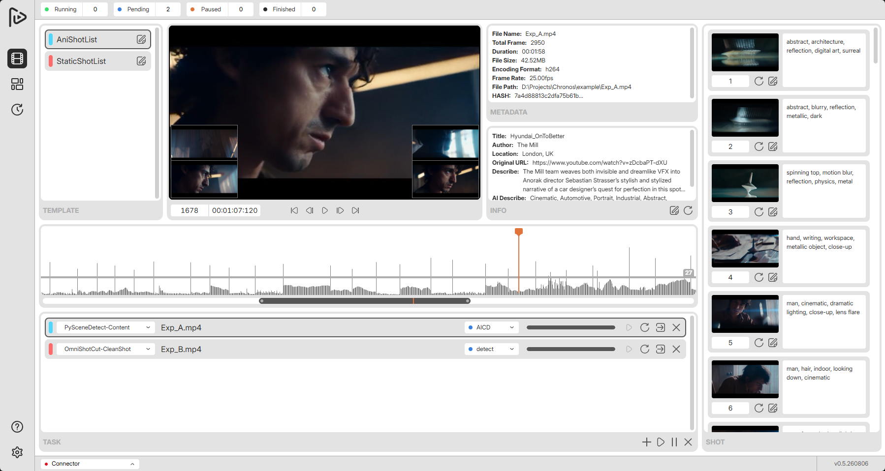
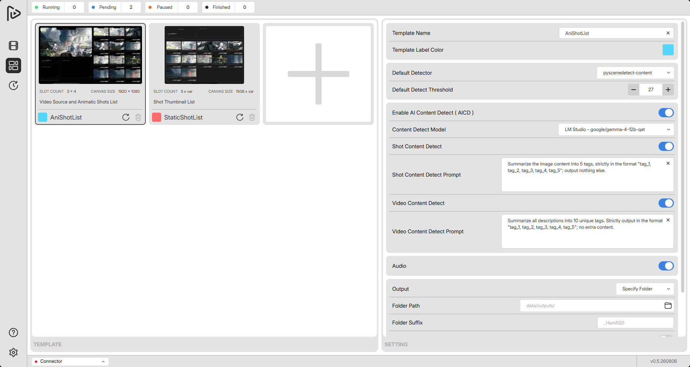
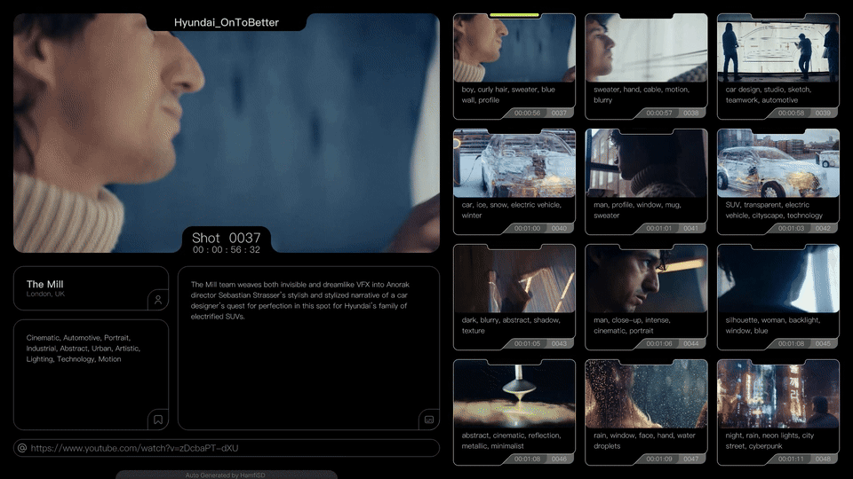
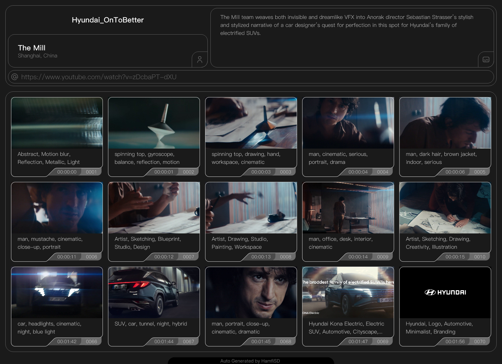

<div align="center">

# HamfiSceneDetect

> Video cut point detection, Shot content analysis, Template-based video processing.

Multiple detection modes · AI Content Detection · Fully local

    

English | [简体中文](README.zh-CN.md)

</div>

---

HamfiSceneDetect (HamfiSD) is a Windows desktop storyboard tool. It breaks a long video into shots by detecting cut points, describes each shot with a multimodal LLM, and rebuilds the footage and text into a storyboard array video (MP4) or a storyboard sheet (PNG) through an SVG template. Footage and caches stay on your machine by default.

## Screenshots & Outputs

|                                              |                                                       |
| :------------------------------------------: | :---------------------------------------------------: |
|                  Processor                   |                       Template                        |
|      |      |
|        Animated Storyboard Array (MP4)       |              Storyboard Array (PNG)                   |
|  |  |

> Sample footage: Hyundai “On To Better” — The Mill. Used for output demonstration only.

## Workflow

| Step | What it does |
| --- | --- |
| **Import** | Import videos through multiple routes, read metadata, build a task list, and assign each task a template. |
| **Detect** | Detect cut points with multiple modes, visualize thresholds, adjust thresholds and cut points interactively, and generate a shot list. |
| **Describe** | Use a multimodal LLM with custom prompts to inspect every shot, generate the information you need, and summarize the results. |
| **Compose** | Produce storyboard arrays in multiple formats from templates, and export shot data, mid-frame thumbnails, and video clips. |

## Features

### Templates define not only the layout, but also the processing

A template is made of an SVG and a rules JSON: the SVG describes the composition style, while the JSON records placement rules and default settings. Each task's processing pipeline is also determined by its assigned template.

### Run the task queue in parallel, and get every task done at once

Imported videos enter a task queue and can be processed in parallel; each task can have its own template, detection mode, and cut point adjustments. The task list shows every task's stage and progress in real time, keeping the whole run under control.

### Cut point detection with multiple modes, fine-tuned from the chart

Four CPU detection modes from PySceneDetect — Content / Adaptive / Threshold / Hash — plus two GPU modes from OmniShotCut, default / clean_shot, and direct import of cut point CSV files generated by Adobe Premiere. Thresholds and cut points are shown on a chart: drag the threshold line to adjust it, or exclude individual frames.

### Tell AI what you need, and let it describe every shot

Write prompts in the template, or define prompts for individual shots. A multimodal model describes each shot as you ask, and can also summarize the whole video. Results can be regenerated one by one or edited by hand before you confirm and compose. LM Studio / DeepSeek / OpenAI are included, and any compatible service can be connected.

### Fully local processing — no data leaks

Footage, caches and results stay on your machine. Only the requests you send to the AI provider you configured leave it.

## Outputs

**Animated Storyboard Array (MP4)** — a video composed from modules such as the source footage, video info, and an animated storyboard array; the composition style is freely defined by the template.

**Storyboard Array (PNG)** — a storyboard sheet composed from modules such as video info and the storyboard array; the composition style is freely defined by the template.

Templates can also export shot data (CSV/JSON), mid-frame thumbnails, and per-shot clips. Results are named `{video_stem}_chronos.mp4` / `{video_stem}_chronos.png` and go to a specified folder (default `data/outputs/`) or to a folder beside the source video.

## Tech Stack

| Layer | Stack |
| --- | --- |
| Backend | FastAPI + Uvicorn, SQLAlchemy + SQLite (WAL), Pydantic Settings |
| Media processing | OpenCV, PySceneDetect, OmniShotCut + PyTorch (optional GPU), FFmpeg / FFprobe |
| SVG engine | resvg / usvg, fontTools, Pillow, affine, NumPy |
| Frontend | Vue 3, TypeScript, Pinia, Vue Router, Vite, Element Plus |
| Desktop shell | PyWebView (WebView2), pystray, Tkinter |
| Packaging | Nuitka `--standalone` with Zig; FULL / LITE modes |

## Getting Started

Prebuilt Windows builds are published on the [Releases](../../releases) page.

### Requirements

- Windows 10 / 11 64-bit; WebView2 Runtime required (preinstalled on Windows 11).
- NVIDIA CUDA required for GPU detection.
- Python 3.11+ (the project is developed against Python 3.14).
- Node.js 18+ if you build the frontend.
- FFmpeg: place `ffmpeg.exe` (and `ffprobe.exe` for GPU detection) in `bin/` (create it if needed), or make them available on `PATH`. These binaries are **not** committed to this repository.

### Install

```bat
git clone https://github.com/wangwenhui0147/Chronos.git
cd Chronos

python -m venv .venv
.venv\Scripts\activate
pip install -U pip

REM Backend dependencies (authoritative list: backend/pyproject.toml)
pip install scenedetect==0.7 opencv-python==5.0.0 numpy==2.5.1 fontTools Pillow resvg affine fastapi httpx "uvicorn[standard]" pydantic-settings sqlalchemy websockets

REM Desktop shell dependencies
pip install pywebview pystray requests
```

### Build the frontend

```bat
cd frontend
npm install
npm run build
cd ..
```

> **Note:** brand fonts (Inter, Source Han Sans) are loaded from `design/Font/`, which is not tracked in this repository. Place the expected files there before building — see [`frontend/src/styles/fonts.css`](frontend/src/styles/fonts.css) for the exact paths.

### Run

```bat
python shell/main.py
```

The shell opens the window immediately with a loading page, starts the backend in the background, and switches to the application once `/api/health` responds. If port 8765 is busy it retries the next port automatically.

You can also run the backend alone:

```bat
python -m uvicorn backend.app.main:app --host 127.0.0.1 --port 8765
```

Or run the frontend with hot reload (backend must be running on port 8765):

```bat
cd frontend
npm run dev
```

### Optional: GPU cut detection

```bat
pip install torch torchvision huggingface_hub "omnishotcut @ git+https://github.com/UVA-Computer-Vision-Lab/OmniShotCut.git"
```

Place `OmniShotCut_v1.5_ckpt.pth` in `data/models/` (Hugging Face is used as a fallback download source). A working CUDA environment is required; without it, the two OmniShotCut modes simply report as unavailable.

## Templates

A template is a folder containing an SVG frame, a JSON rule set and font files. Built-in templates live in `backend/templates/`; user templates live in `data/templates/{template_id}/` and take precedence.

A v2 template JSON looks like this:

```jsonc
{
  "name": "AniShotList",
  "productionType": "video",                      // "video" | "image"
  "canvasSize": { "resX": 1920, "resY": 1080 },   // one axis may be "variable"
  "numShots":   { "numX": 3, "numY": 4 },         // one axis may be "variable"

  "shotHighlight": {
    "highlightEnable": true,
    "highlightcomponentID": ["S_Highlight", "S_Highlight_2"]
  },

  "rules": [
    {
      "type": "v_Shot",                           // image slot
      "resX": 276, "resY": 155,
      "frameID":   ["V_Shot", "V_Shot_2"],
      "patternId": ["pattern0_0_1", "pattern1_0_1"],
      "imageId":   ["image0_0_1", "image1_0_1"]
    },
    {
      "type": "t_ShotNum",                        // text slot
      "boundingbox": "B_ShotNum",
      "alignmentX": "center",
      "alignmentY": "middle",
      "maxlines": 1,
      "font": "PingFang-Regular.ttf",
      "frameID": ["T_ShotNum", "T_ShotNum_2"]
    }
  ]
}
```

Key points:

- image rules start with `v_` or `i_`; text rules start with `t_`;
- `v_Shot` / `i_Shot` define the array slots, so their count determines the slot count;
- `canvasSize` and `numShots` may each have at most one `"variable"` axis, and the variable axis must match;
- fonts referenced by `font` must exist in the template directory.

Built-in templates:

| Template | Production type | Description |
| --- | --- | --- |
| `TPL_AniShotList` | `video` | Video source panel plus an animatic shot list grid |
| `TPL_StaticShotList` | `image` | Static storyboard sheet with a variable-height canvas |

Each template also carries its own processing settings — detector and threshold, AICD toggles and prompts, audio, and output options — edited on the Template page. AI services are configured on the Settings page; only providers with a URL, model and API key appear in a template's *Content Detect Model* dropdown.

## Developer Reference

### Project layout

```text
Chronos/
├── backend/
│   ├── app/
│   │   ├── api/          REST routes + WebSocket
│   │   ├── core/         domain core: models, detection, shots, svg
│   │   ├── infra/        database, storage, task runner
│   │   ├── schemas/      Pydantic request/response models
│   │   └── services/     video / detection / compose / task / template / config / AI provider
│   ├── templates/        built-in .svg + .json templates
│   ├── cli.py            detect / shots / compose
│   └── pyproject.toml    backend dependencies (incl. optional gpu extra)
├── frontend/src/         Vue 3 SPA: 4 pages, 18 widgets, Pinia stores
├── shell/                PyWebView window, tray panel, native dialogs
├── doc/                  master spec and workflow documents
├── docs/                 landing page and README images
├── bin/                  ffmpeg.exe / ffprobe.exe (not committed)
├── build.bat             FULL build
├── build_Lite.bat        LITE build
└── build_vendor.py       copies the GPU stack into dist/vendor
```

### CLI

```bat
python -m backend.cli detect --video input.mp4 --detector pyscenedetect-content -o cut_points.json
python -m backend.cli shots  --video input.mp4 --detector pyscenedetect-content -o shots.json
python -m backend.cli compose --video input.mp4 --template TPL_AniShotList --cut-json cut_points.json -o output.mp4
```

The CLI reuses the domain core only (no FastAPI). It currently supports detection, shot listing and video composition — pipeline tasks, image output and AI providers are GUI/API-only.

### HTTP and WebSocket API

REST is served under `/api`, with route groups for videos, detection, shots, compose, pipeline, tasks, templates, configs, detectors, AI providers, connectors and system paths. Task updates stream over `WS /api/ws/tasks/{task_id}` with message types `status`, `stage`, `progress`, `awaiting`, `paused`, `resumed`, `completed`, `cancelled` and `failed`.

The complete endpoint and message contract lives in the [master spec](doc/master-spec-v0.5.md), chapters 7 and 10.

### Data and configuration

```text
data/
├── db/chronos.db         SQLite database (WAL)
├── cache/                thumbnails, frame scores, exclusions, preview proxies
├── templates/            user templates
├── outputs/              default output folder
├── imports/              drag-and-drop / upload copies
├── models/               OmniShotCut checkpoints
├── logs/                 backend.log, shell.log
└── webview2/             WebView2 user data
```

- `data/bootstrap.json` can override the cache, database and template directories (restart required).
- Settings use the `CHRONOS_` environment variable prefix and an optional `.env` file.
- `data/`, `bin/`, `design/` and `example/` are gitignored: provide your own FFmpeg binaries, model weights and sample media.

### Building

```bat
REM FULL: dist\Chronos\Chronos.exe (GPU stack in vendor\)
build.bat

REM LITE: dist\Chronos_Lite\Chronos_Lite.exe (no GPU stack)
build_Lite.bat
```

Both scripts use Nuitka `--standalone` with Zig and require a built `frontend/dist` plus all dependencies installed in `.venv`. Builds are portable folders; no installer is created.

## Limitations & Roadmap

- The desktop shell is Windows-only (PyWebView + WebView2); the backend and CLI can run independently.
- The History page is currently a design placeholder with no history data model.
- Internationalization is partial: the GUI is English while some messages are Chinese.
- CLI capabilities are narrower than the GUI (no pipeline, image output or AI provider support).
- User template creation does not yet support uploading font files.
- A few endpoints (`/preflight`, `/cuts/chart`) and three processors remain stubs.
- Possible future work: a history/artifact index, complete i18n, and macOS/Linux shells.

## Documentation

- [Master spec v0.5](doc/master-spec-v0.5.md) — authoritative architecture, API, data model and ADR record
- [Core workflow](doc/master-workflow_v01.md) — import, template assignment, detection, AI and export
- [Highlight workflow](doc/highlight-workflow_v01.md) — template list / task list highlight linkage

## Contributing

Issues and pull requests are welcome. For larger changes, please open an issue first so the approach can be discussed. Keep the backend's domain core free of web/ORM dependencies, and keep changes aligned with the contracts in the master spec.

## License

[MIT](LICENSE) © 2026 ZalvinFish

## Acknowledgements

HamfiSD builds on [PySceneDetect](https://github.com/Breakthrough/PySceneDetect), [OmniShotCut](https://github.com/UVA-Computer-Vision-Lab/OmniShotCut), [resvg](https://github.com/RazrFalcon/resvg), [fontTools](https://github.com/fonttools/fonttools), [OpenCV](https://opencv.org/), [FFmpeg](https://ffmpeg.org/), [FastAPI](https://fastapi.tiangolo.com/), [Vue.js](https://vuejs.org/), [PyWebView](https://pywebview.flowrl.com/) and [Nuitka](https://nuitka.net/). Thanks to the maintainers of these projects.
