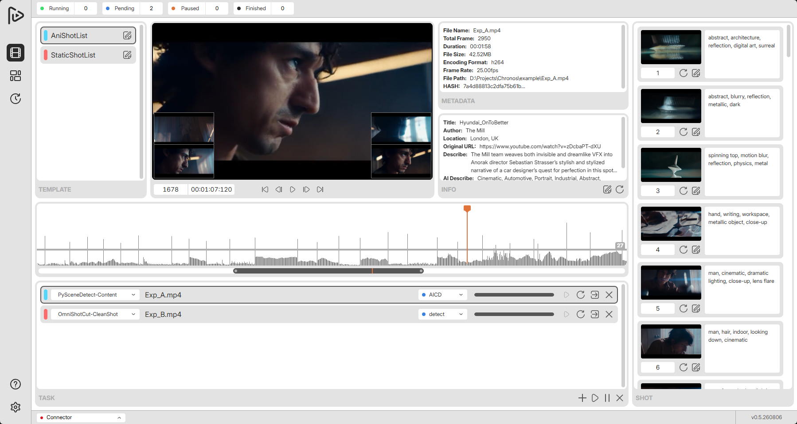
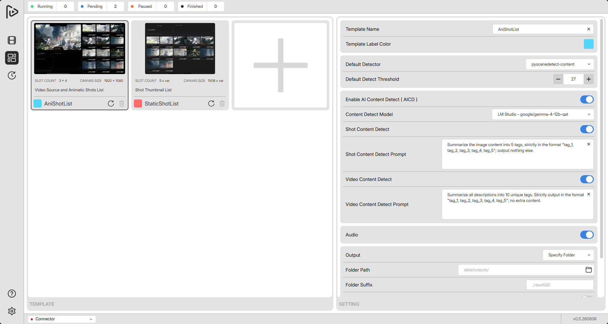
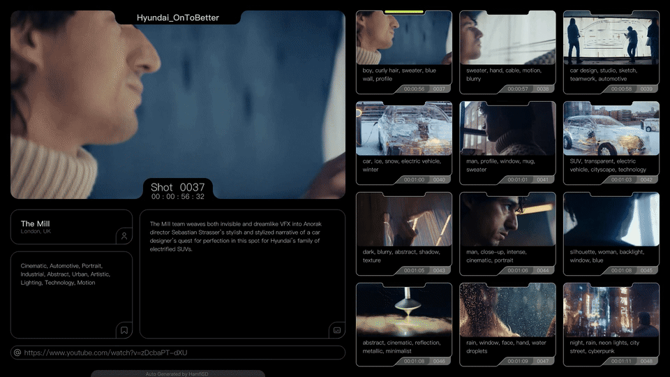
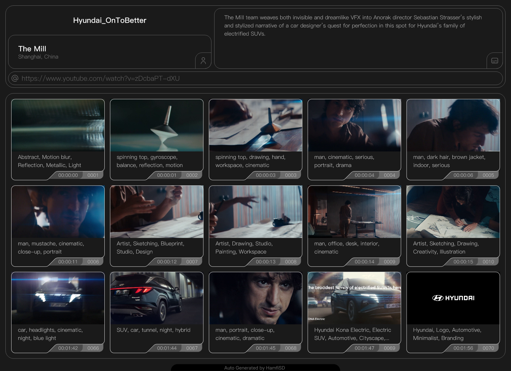

<div align="center">

# HamfiSceneDetect

> 剪辑点检测、镜头内容分析、模板化视频处理。

多种检测模式 · AI 内容识别 · 完全本地

    

[English](README.md) | 简体中文

</div>

---

HamfiSceneDetect（HamfiSD）是一款桌面剪辑点检测和视频处理工具。它通过剪辑点检测把长视频切分为镜头，用多模态大模型获取每个镜头所需信息，再按 SVG 模板把画面与文字重组成一段动态分镜阵列视频（MP4）或一张分镜阵列图（PNG）。素材与缓存默认留在本机。

## 界面与产出

|                                              |                                                       |
| :------------------------------------------: | :---------------------------------------------------: |
|                  处理器页面                  |                      模板页面                         |
|      |      |
|            动态分镜阵列（MP4）              |                  分镜阵列（PNG）                      |
|  |  |

> 示例素材：Hyundai “On To Better” — The Mill，仅用于产出效果演示。

## 工作流

| 步骤 | 说明 |
| --- | --- |
| **导入** | 通过多种方式导入视频，读取元数据，建立任务列表，并为每个任务赋予模板。 |
| **检测** | 使用多种模式检测剪辑点，在图表上可视化阈值，交互式调整阈值与剪辑点，并生成镜头列表。 |
| **描述** | 用自定义提示词驱动多模态大模型逐个检查镜头，生成你需要的信息，并对结果做汇总。 |
| **合成** | 按模板产出多种形式的分镜阵列，并导出分镜数据、中间帧缩略图与视频片段。 |

## 功能特性

### 模板不只定义排版，也定义处理方式

一个模板由 SVG 与规则 JSON 组成：SVG 描述画面风格，JSON 记录图位/文字替换规则与默认设置。每个任务使用哪个模板，也就决定了它走哪条处理流程。

### 并行运行任务队列，一次把所有任务跑完

导入的视频进入任务队列后可并行处理；每个任务可以有自己的模板、检测模式与剪辑点调整。任务列表实时显示每个任务的阶段与进度，整个过程尽在掌握。

### 多种剪辑点检测模式，在图表上精细调整

PySceneDetect 提供四种 CPU 检测模式——Content / Adaptive / Threshold / Hash，OmniShotCut 提供两种 GPU 模式——default / clean_shot，另支持直接导入 Adobe Premiere 导出的剪辑点 CSV。阈值与剪辑点会显示在图表上：拖动阈值线即可调整，也可以排除个别帧。

### 告诉 AI 你需要什么，让它描述每一个镜头

可以在模板里写提示词，也可以为单个镜头单独定义提示词。多模态模型会按你的要求描述每个镜头，还能对整段视频做汇总。结果既可以逐个重新生成，也可以手动编辑，确认后再合成。内置 LM Studio / DeepSeek / OpenAI，任何兼容服务都可以接入。

### 完全本地处理，不泄露数据

素材、缓存与结果都留在本机，只有你向所配置的 AI 服务发出的请求会离开本地。

## 产出

**动态分镜阵列（MP4）**——由源视频、视频信息、动态分镜阵列等模块组合而成的视频，画面风格完全由模板定义。

**分镜阵列（PNG）**——由视频信息、分镜阵列等模块组合而成的分镜图，画面风格完全由模板定义。

模板还可以额外导出分镜数据（CSV/JSON）、中间帧缩略图与逐镜头片段。产物命名为 `{video_stem}_chronos.mp4` / `{video_stem}_chronos.png`，输出到指定目录（默认 `data/outputs/`）或源视频旁的独立文件夹。

## 技术栈

| 层次 | 技术 |
| --- | --- |
| 后端 | FastAPI + Uvicorn、SQLAlchemy + SQLite（WAL）、Pydantic Settings |
| 媒体处理 | OpenCV、PySceneDetect、OmniShotCut + PyTorch（可选 GPU）、FFmpeg / FFprobe |
| SVG 引擎 | resvg / usvg、fontTools、Pillow、affine、NumPy |
| 前端 | Vue 3、TypeScript、Pinia、Vue Router、Vite、Element Plus |
| 桌面壳 | PyWebView（WebView2）、pystray、Tkinter |
| 打包 | Nuitka `--standalone` + Zig；FULL / LITE 两种模式 |

## 快速开始

Windows 预编译版本发布在 [Releases](../../releases) 页面。

### 环境要求

- Windows 10 / 11 64 位；需要 WebView2 Runtime（Windows 11 已预装）。
- GPU 检测需要 NVIDIA CUDA。
- Python 3.11+（项目在 Python 3.14 下开发）。
- 构建前端需要 Node.js 18+。
- FFmpeg：把 `ffmpeg.exe`（GPU 检测另需 `ffprobe.exe`）放入 `bin/`（不存在则自行创建），或加入 `PATH`。这些二进制文件**不会**随仓库提交。

### 安装

```bat
git clone https://github.com/wangwenhui0147/Chronos.git
cd Chronos

python -m venv .venv
.venv\Scripts\activate
pip install -U pip

REM 后端依赖（权威列表见 backend/pyproject.toml）
pip install scenedetect==0.7 opencv-python==5.0.0 numpy==2.5.1 fontTools Pillow resvg affine fastapi httpx "uvicorn[standard]" pydantic-settings sqlalchemy websockets

REM 桌面壳依赖
pip install pywebview pystray requests
```

### 构建前端

```bat
cd frontend
npm install
npm run build
cd ..
```

> **注意：** 品牌字体（Inter、思源黑体）从 `design/Font/` 加载，该目录不随仓库提交。构建前请按 [`frontend/src/styles/fonts.css`](frontend/src/styles/fonts.css) 中的路径放入对应字体文件。

### 运行

```bat
python shell/main.py
```

桌面壳会立即打开窗口并显示加载页，在后台启动后端进程，待 `/api/health` 响应后切换到应用页面。若 8765 端口被占用，会自动尝试后续端口。

也可以只启动后端：

```bat
python -m uvicorn backend.app.main:app --host 127.0.0.1 --port 8765
```

或使用热更新的前端开发模式（后端需已在 8765 端口运行）：

```bat
cd frontend
npm run dev
```

### 可选：GPU 剪辑点检测

```bat
pip install torch torchvision huggingface_hub "omnishotcut @ git+https://github.com/UVA-Computer-Vision-Lab/OmniShotCut.git"
```

把 `OmniShotCut_v1.5_ckpt.pth` 放入 `data/models/`（缺失时会尝试从 Hugging Face 下载）。需要可用的 CUDA 环境；否则两种 OmniShotCut 模式会显示为不可用。

## 模板系统

模板是一个目录，包含框架 SVG、规则 JSON 与字体文件。内置模板位于 `backend/templates/`，用户模板位于 `data/templates/{template_id}/`，同名时用户模板优先。

v2 模板 JSON 示例如下：

```jsonc
{
  "name": "AniShotList",
  "productionType": "video",                      // "video" | "image"
  "canvasSize": { "resX": 1920, "resY": 1080 },   // 一个轴可为 "variable"
  "numShots":   { "numX": 3, "numY": 4 },         // 一个轴可为 "variable"

  "shotHighlight": {
    "highlightEnable": true,
    "highlightcomponentID": ["S_Highlight", "S_Highlight_2"]
  },

  "rules": [
    {
      "type": "v_Shot",                           // 图片位规则
      "resX": 276, "resY": 155,
      "frameID":   ["V_Shot", "V_Shot_2"],
      "patternId": ["pattern0_0_1", "pattern1_0_1"],
      "imageId":   ["image0_0_1", "image1_0_1"]
    },
    {
      "type": "t_ShotNum",                        // 文本规则
      "boundingbox": "B_ShotNum",
      "alignmentX": "center",
      "alignmentY": "middle",
      "maxlines": 1,
      "font": "PingFang-Regular.ttf",
      "frameID": ["T_ShotNum", "T_ShotNum_2"]
    }
  ]
}
```

要点：

- 图片规则以 `v_` 或 `i_` 开头，文本规则以 `t_` 开头；
- `v_Shot` / `i_Shot` 定义阵列槽位，其数量决定槽位数；
- `canvasSize` 与 `numShots` 各至多一个 `"variable"` 轴，且可变轴必须一致；
- `font` 引用的字体文件必须存在于模板目录中。

内置模板：

| 模板 | 产出类型 | 说明 |
| --- | --- | --- |
| `TPL_AniShotList` | `video` | 左侧视频源区 + 动画分镜阵列 |
| `TPL_StaticShotList` | `image` | 可变高度画布的静态分镜表 |

每个模板还各自携带处理设置——检测模式与阈值、AICD 开关与提示词、音频、输出选项，均在模板页中编辑。AI 服务在设置页配置；只有填好 URL、模型与 API Key 的 Provider 才会出现在模板的 *Content Detect Model* 下拉中。

## 开发者参考

### 项目结构

```text
Chronos/
├── backend/
│   ├── app/
│   │   ├── api/          REST 路由 + WebSocket
│   │   ├── core/         领域核心：models / detection / shots / svg
│   │   ├── infra/        数据库、存储、任务运行器
│   │   ├── schemas/      Pydantic 请求/响应模型
│   │   └── services/     video / detection / compose / task / template / config / AI provider
│   ├── templates/        内置 .svg + .json 模板
│   ├── cli.py            detect / shots / compose
│   └── pyproject.toml    后端依赖（含可选 gpu extra）
├── frontend/src/         Vue 3 SPA：4 个页面、18 个设计系统组件、Pinia store
├── shell/                PyWebView 窗口、托盘面板、原生对话框
├── doc/                  master spec 与工作流文档
├── docs/                 落地页与 README 图片
├── bin/                  ffmpeg.exe / ffprobe.exe（不提交）
├── build.bat             FULL 构建
├── build_Lite.bat        LITE 构建
└── build_vendor.py       把 GPU 栈复制到 dist/vendor
```

### 命令行

```bat
python -m backend.cli detect --video input.mp4 --detector pyscenedetect-content -o cut_points.json
python -m backend.cli shots  --video input.mp4 --detector pyscenedetect-content -o shots.json
python -m backend.cli compose --video input.mp4 --template TPL_AniShotList --cut-json cut_points.json -o output.mp4
```

CLI 只复用领域核心（不依赖 FastAPI），当前支持检测、镜头列表与视频合成——流水线任务、图片产出与 AI Provider 仅由 GUI/API 提供。

### HTTP 与 WebSocket API

REST 统一挂在 `/api` 下，路由组包括 videos、detection、shots、compose、pipeline、tasks、templates、configs、detectors、AI providers、connectors 与 system paths。任务更新通过 `WS /api/ws/tasks/{task_id}` 推送，消息类型包括 `status`、`stage`、`progress`、`awaiting`、`paused`、`resumed`、`completed`、`cancelled` 与 `failed`。

完整的端点与消息契约见 [master spec](doc/master-spec-v0.5.md) 第 7、10 章。

### 数据与配置

```text
data/
├── db/chronos.db         SQLite 数据库（WAL）
├── cache/                缩略图、逐帧分数、排除帧、预览代理
├── templates/            用户模板
├── outputs/              默认输出目录
├── imports/              拖拽/上传导入的落盘副本
├── models/               OmniShotCut 权重
├── logs/                 backend.log、shell.log
└── webview2/             WebView2 用户数据目录
```

- `data/bootstrap.json` 可覆盖缓存、数据库与模板目录（重启生效）。
- 配置支持 `CHRONOS_` 环境变量前缀与可选 `.env` 文件。
- `data/`、`bin/`、`design/`、`example/` 均被 gitignore：请自行提供 FFmpeg 二进制、模型权重与示例媒体。

### 构建

```bat
REM FULL：dist\Chronos\Chronos.exe（GPU 栈位于 vendor\）
build.bat

REM LITE：dist\Chronos_Lite\Chronos_Lite.exe（不含 GPU 栈）
build_Lite.bat
```

两个脚本均使用 Nuitka `--standalone` + Zig，要求已构建 `frontend/dist`，且 `.venv` 中依赖齐全。产物是便携目录，不生成安装器。

## 已知限制与路线图

- 桌面壳仅支持 Windows（PyWebView + WebView2）；后端与 CLI 可独立运行。
- History 页目前只是设计占位，没有历史数据模型。
- 国际化不完整：界面主要为英文，部分提示仍为中文。
- CLI 能力弱于 GUI（不支持流水线、图片产出与 AI Provider）。
- 创建用户模板暂不支持上传字体文件。
- 少量端点（`/preflight`、`/cuts/chart`）与三个处理器仍为占位实现（stub）。
- 后续可能的方向：历史记录/产物索引、全量 i18n、macOS/Linux 桌面壳。

## 文档

- [核心开发文档 v0.5](doc/master-spec-v0.5.md)——权威架构、API、数据模型与 ADR 记录
- [核心工作流](doc/master-workflow_v01.md)——导入、模板赋值、检测、AI 与导出
- [高亮联动工作流](doc/highlight-workflow_v01.md)——模板列表与任务列表的高亮联动

## 贡献

欢迎提交 Issue 与 Pull Request。较大改动请先开 Issue 讨论方案。请保持后端领域核心不依赖 Web/ORM，并与 master spec 中的契约保持一致。

## 许可证

[MIT](LICENSE) © 2026 ZalvinFish

## 致谢

HamfiSD 建立在 [PySceneDetect](https://github.com/Breakthrough/PySceneDetect)、[OmniShotCut](https://github.com/UVA-Computer-Vision-Lab/OmniShotCut)、[resvg](https://github.com/RazrFalcon/resvg)、[fontTools](https://github.com/fonttools/fonttools)、[OpenCV](https://opencv.org/)、[FFmpeg](https://ffmpeg.org/)、[FastAPI](https://fastapi.tiangolo.com/)、[Vue.js](https://vuejs.org/)、[PyWebView](https://pywebview.flowrl.com/) 与 [Nuitka](https://nuitka.net/) 之上。感谢这些项目的维护者。
